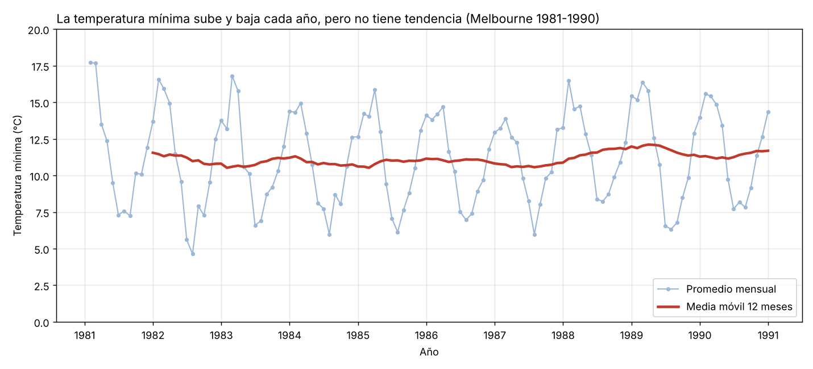

# Semana 11 - Análisis de una serie de tiempo

Yilver Medina Urrea ([@yilvermedina](https://github.com/yilvermedina)) · Electiva VI Ciencia de Datos · Corte 3

## Datos

Para esta actividad usé la temperatura mínima diaria de Melbourne (Australia) entre 1981 y 1990. Son 3.650 registros, uno por día, y se pueden descargar de GitHub ([fuente](https://raw.githubusercontent.com/jbrownlee/Datasets/master/daily-min-temperatures.csv), datos del servicio meteorológico de Australia). El archivo quedó en `data/temperaturas_melbourne.csv`.

La escogí porque es una serie real y larga (10 años). Con los datos de Nübe no me alcanzaba, porque solo tengo 8 semanas de ventas y al agrupar por mes me quedaban 2 puntos.

## Qué hice

1. Cargué el CSV con pandas y dejé la fecha como índice (`set_index("fecha")`).
2. Lo agrupé por mes con `resample`, sacando el promedio de cada mes. Quedaron 120 meses.
3. Calculé la media móvil de 12 meses con `rolling`. Usé 12 porque es un año completo: cada punto promedia todas las estaciones, entonces lo que queda es la tendencia.

```python
mensual = df["temp_min"].resample("ME").mean()
media_movil = mensual.rolling(window=12).mean()
```

## Gráfico



La línea azul es el promedio de cada mes y la roja es la media móvil. La roja empieza en diciembre de 1981 porque antes no hay 12 meses para promediar.

## Tendencia y estacionalidad

**Tendencia:** no hay. La media móvil se queda entre 10,5 y 12,1 °C en los 10 años, empieza en 11,6 °C y termina en 11,7 °C. Hubo años un poco más calientes (1988, con 12,0 °C de promedio) y otros más fríos (1984, con 10,6 °C), pero no va subiendo ni bajando.

**Estacionalidad:** es muy marcada y se repite igual cada año. Lo más caliente es enero y febrero (unos 15 °C) y lo más frío junio y julio (unos 7 °C), casi 9 grados de diferencia. Es al revés que en el norte porque Australia está en el hemisferio sur.

Me llamó la atención porque en Neiva esto casi no pasa: como estamos cerca de la línea del ecuador, la temperatura es parecida todo el año y lo que más cambia son las lluvias.

## Cómo correrlo

```bash
cd 11-week
pip install pandas matplotlib
python serie_tiempo.py
```
