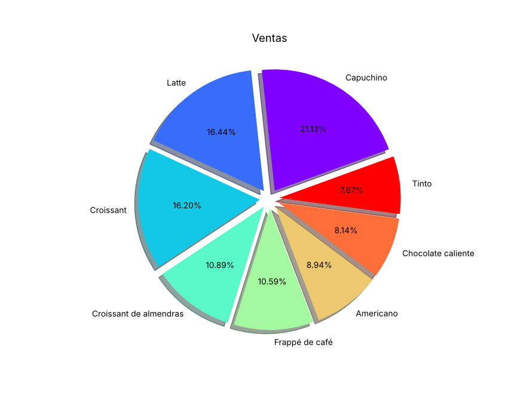
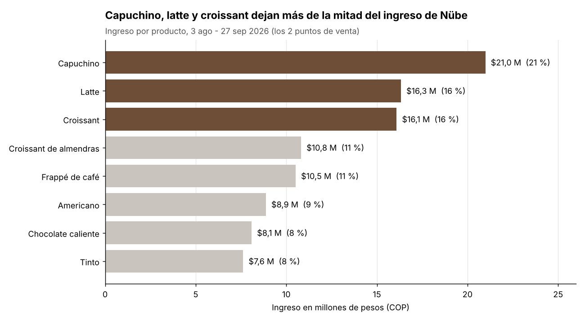

# Semana 12 - Rediseño de un gráfico

Yilver Medina Urrea ([@yilvermedina](https://github.com/yilvermedina)) · Electiva VI Ciencia de Datos · Corte 3

Usé las ventas de Nübe Coffee Lab (los datos que limpié en la semana 10, del 3 de agosto al 27 de septiembre) para mostrar cuánto dinero deja cada producto. Primero hice el gráfico mal, como lo hace mucha gente, y después lo rediseñé.

## Antes



Problemas que le encontré:

- Es una torta con 8 partes. Con tantas no se puede comparar: el latte (16,4 %) y el croissant (16,2 %) se ven casi iguales y no se sabe cuál es más grande sin leer el número.
- Los colores tipo arcoíris no significan nada, solo distraen. Las partes separadas y la sombra tampoco aportan, solo hacen ver el gráfico más cargado.
- Los porcentajes tienen dos decimales (21,13 %), más precisión de la que hace falta.
- El título "Ventas" no dice qué se mide, en qué periodo ni en qué unidades, y no da ninguna conclusión.

## Después



## Qué mejoré y por qué

Cambié la torta por barras horizontales ordenadas de mayor a menor, porque es más fácil comparar largos que ángulos y los nombres largos se leen completos. El eje empieza en 0 para que el tamaño de cada barra sea honesto, y cada barra tiene su valor en millones y su porcentaje. Usé un solo color (café) para los tres productos que más dejan y gris para el resto, así el color sí dice algo. Y el título ahora cuenta la conclusión: capuchino, latte y croissant dejan el 54 % del ingreso.

Algo que en la torta no se veía: el tinto es el segundo producto que más se vende en unidades (2.539), pero es el que menos plata deja porque vale $3.000.

## Cómo correrlo

```bash
cd 12-week
pip install pandas matplotlib
python redisenio_grafico.py
```
