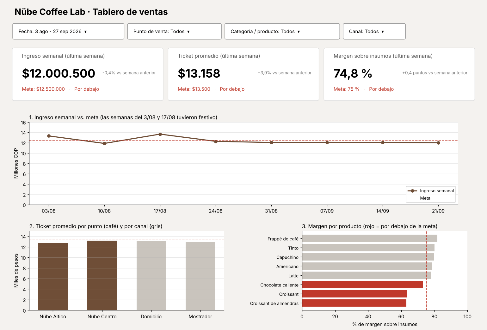

# Semana 13 - Diseño de un dashboard

Yilver Medina Urrea ([@yilvermedina](https://github.com/yilvermedina)) · Electiva VI Ciencia de Datos · Corte 3

Escogí el proceso de **ventas** de Nübe Coffee Lab, que es el caso que vengo trabajando. El tablero sería para el dueño, que lo revisaría cada lunes para ver cómo le fue la semana anterior.

## KPIs

1. **Ingreso semanal:** cuánta plata entró en la semana (lunes a domingo) sumando los dos puntos. Objetivo: **$12.500.000 por semana**. Hoy una semana normal da unos $12.050.000, entonces la meta es subir más o menos un 4 %, sobre todo vendiendo más de lunes a miércoles, que son los días más flojos.
2. **Ticket promedio:** el ingreso dividido entre el número de ventas. Objetivo: **$13.500**. Hoy está en $12.956 en promedio, y la idea es subirlo con combos de bebida + croissant.
3. **Margen sobre insumos:** (ingreso − costo de los insumos según la receta) / ingreso. Objetivo: **75 % o más**. Hoy está en 74,6 %. Lo que más lo baja son los croissants, que dejan solo un 63 %.

## Boceto



Lo hice en Python con los datos reales de la semana 10 para ver cómo quedaría de verdad, pero la idea es montarlo después en Power BI.

| KPI | Gráfico | Por qué ese gráfico |
|---|---|---|
| Ingreso semanal | Línea por semana con la meta punteada | Es algo que cambia en el tiempo; la línea muestra si sube o baja y qué tan lejos está de la meta |
| Ticket promedio | Barras por punto de venta y por canal, con la meta | Para comparar dónde se gasta más cada cliente |
| Margen sobre insumos | Barras horizontales por producto, en rojo las que no llegan a la meta | Para ver rápido qué producto está bajando el margen |

**Filtros** (arriba del tablero, afectan las tarjetas y los tres gráficos):

- Fecha: un rango, para ver una semana, un mes o todo el periodo.
- Punto de venta: Nübe Centro o Nübe Altico.
- Categoría / producto: bebidas calientes, frías, panadería o un producto en particular.
- Canal: mostrador o domicilio.

## Orden y jerarquía visual

Arriba van los filtros, porque cambian todo lo demás y es lo primero que uno ajusta. Debajo están las tres tarjetas con el valor de la última semana, la meta y si cumple o no: es lo que el dueño tiene que ver en 5 segundos, y quedan arriba a la izquierda, que es donde uno empieza a leer. Después va el ingreso semanal ocupando todo el ancho, porque es el KPI principal (si no entra plata, lo demás no importa mucho). Abajo quedan el ticket y el margen, que sirven para entender el porqué cuando una tarjeta sale en rojo. El rojo lo usé solo para lo que está por debajo de la meta, así el color sí avisa algo.

## Cómo correrlo

```bash
cd 13-week
pip install pandas matplotlib
python boceto_dashboard.py
```
