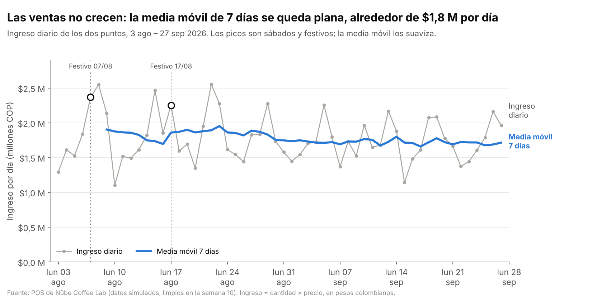
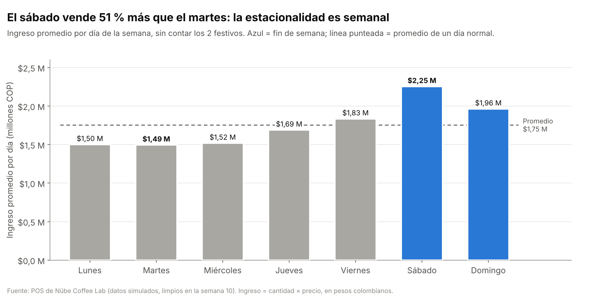

# Semana 14 · Corte 3 — Análisis temporal y visualización: Nübe Coffee Lab

> **Asignatura:** Ciencia de Datos · Corte 3 — Análisis temporal y visualización
> **Estudiante:** Yilver Medina Urrea · [@yilvermedina](https://github.com/yilvermedina)
> **Programa:** Ingeniería Mecatrónica
> **Periodo:** 2026-B · Corte 3 · Semana 4 del corte (semana 14)
> **Modalidad:** Individual

---

## 0. Resumen

Sigo con mi caso, **Nübe Coffee Lab**, y parto de los datos que dejé limpios en el mini-proyecto de la [semana 10](../10-week/README.md) (`ventas_limpias.csv`).

| Punto del enunciado | Qué hice | Dónde está |
|---|---|---|
| 1. Serie temporal + `resample` + media móvil | Ingreso por ventas agregado por día y por semana, media móvil de 7 días, tendencia y estacionalidad | [`analisis_temporal.py`](analisis_temporal.py) · [sección 1](#1-serie-temporal-resample--media-móvil) |
| 2. Dos visualizaciones | Evolución (línea) y comparación (barras) con título-conclusión y ejes desde cero | [`graficas/`](graficas) · [sección 2](#2-visualizaciones) |
| 3. Optimizar una consulta SQL | La consulta del ingreso diario: antes / después, con plan de ejecución y tiempos | [`optimizacion_sql.py`](optimizacion_sql.py) · [sección 3](#3-optimización-de-una-consulta-sql) |
| Requisito en inglés | Sección *Findings* | [sección 4](#4-findings) |

**Conclusión en una línea:** las ventas de Nübe **no tienen tendencia de crecimiento** (son planas), pero sí una **estacionalidad semanal fuerte**: el sábado vende **51 % más** que el martes, y los festivos se comportan como un sábado.

**Cómo ejecutarlo:**

```bash
cd 14-week
pip install pandas matplotlib
python analisis_temporal.py   # serie temporal, resample, media móvil y las 2 gráficas
python optimizacion_sql.py    # crea nube.db y compara la consulta antes/después
```

> ⚠️ Los datos son **simulados** (semilla fija, semana 7) y limpiados en la semana 10. Cubren **8 semanas**: del lunes 3 de agosto al domingo 27 de septiembre de 2026.

---

## 1. Serie temporal (resample + media móvil)

### 1.1 Indicador

Uso el **ingreso por ventas** en pesos (COP) de los dos puntos, porque es lo que el dueño mira todos los días:

```python
df["ingreso"] = df["cantidad"] * df["precio_unitario"]   # pesos de cada línea de venta
ventas = df.set_index("fecha").sort_index()              # el índice de fechas convierte la tabla en serie temporal
```

| Dato | Valor |
|---|---:|
| Líneas de venta | 11.858 |
| Tickets (ventas) | 7.665 |
| Días | 56 (ninguno sin ventas) |
| Ingreso total | $99,3 millones |
| Ticket promedio | $12.956 |

### 1.2 Agregación por periodo con `resample`

```python
diario  = ventas["ingreso"].resample("D").sum()        # un valor por día   -> 56 puntos
semanal = ventas["ingreso"].resample("W-SUN").sum()    # semana lunes-domingo -> 8 puntos
```

Uso `"W-SUN"` para que cada semana vaya de **lunes a domingo**, igual que la operación del café (los datos empiezan un lunes y terminan un domingo, así que las 8 semanas quedan completas).

| Semana | Ingreso (millones COP) | Festivos en la semana |
|---|---:|:---:|
| 03/08 – 09/08 | 13,32 | 1 (vie 7) |
| 10/08 – 16/08 | 11,87 | 0 |
| 17/08 – 23/08 | 13,67 | 1 (lun 17) |
| 24/08 – 30/08 | 12,27 | 0 |
| 31/08 – 06/09 | 12,05 | 0 |
| 07/09 – 13/09 | 12,08 | 0 |
| 14/09 – 20/09 | 12,05 | 0 |
| 21/09 – 27/09 | 12,00 | 0 |

### 1.3 Media móvil de 7 días

```python
media_movil_7d = diario.rolling(window=7).mean()
```

Escogí una ventana de **7 días** porque es exactamente una semana: cada valor promedia un lunes, un martes… y un domingo, así que **se cancela el efecto del día de la semana** y queda solo la tendencia. Los primeros 6 días no tienen valor (`NaN`) porque todavía no hay 7 días para promediar; por eso la línea azul de la gráfica empieza el 9 de agosto.

| | Valor |
|---|---:|
| Primer valor (09/08) | $1,90 M/día |
| Último valor (27/09) | $1,71 M/día |
| Mínimo · máximo | $1,66 M · $1,95 M |
| Promedio en agosto · septiembre | $1,84 M · $1,72 M |

### 1.4 Tendencia: plana

A primera vista la media móvil **baja un 10 %** de agosto a septiembre. Pero al mirar la tabla semanal se ve por qué: **las dos semanas con festivo** (7 y 17 de agosto) venden **$13,50 M** en promedio, y las otras seis venden **$12,05 M**. Si se ajusta una recta a los totales semanales:

| Recta sobre… | Pendiente |
|---|---:|
| Las 8 semanas | −1,3 % por semana |
| Las 6 semanas sin festivo | **+0,0 % por semana** |

**Interpretación:** no hay crecimiento ni caída real. La "bajada" es un efecto del **calendario** (agosto tuvo dos festivos y septiembre ninguno), no del negocio. La tendencia es **estable**, alrededor de **$12 M por semana** (≈ $1,75 M por día normal).

### 1.5 Estacionalidad: semanal

Promedio por día de la semana **sin contar los 2 festivos** (un festivo es otro tipo de día). El **índice estacional** es el promedio de ese día dividido entre el promedio de un día normal ($1,75 M): mayor que 1 = vende más de lo normal.

| Día | Ingreso promedio (millones COP) | Índice estacional |
|---|---:|---:|
| Lunes | 1,50 | 0,86 |
| Martes | **1,49** | **0,85** |
| Miércoles | 1,52 | 0,87 |
| Jueves | 1,69 | 0,96 |
| Viernes | 1,83 | 1,05 |
| Sábado | **2,25** | **1,29** |
| Domingo | 1,96 | 1,12 |

**Interpretación:**

- De **lunes a miércoles** se vende 13–15 % menos que un día normal; de **viernes a domingo**, más. El **sábado** es el mejor día (+29 %) y vende **51 % más que el martes**.
- Los **festivos** se comportan como un sábado: el 7/08 vendió $2,37 M y el 17/08 $2,25 M, frente a $1,75 M de un día normal.
- Esto cuadra con la semana 10: allí el sábado gastaba **55 % más leche** que un miércoles. La compra de insumos y los turnos se deben planear **por día de la semana**, no con un valor fijo.

> **Límite:** con 8 semanas solo se puede ver la estacionalidad **semanal**. Para ver una estacionalidad anual (temporada de lluvias, diciembre, vacaciones de mitad de año) harían falta al menos 12 meses de datos.

---

## 2. Visualizaciones

### 2.1 Evolución: ingreso diario y media móvil



- **Por qué línea:** el eje x es el tiempo y lo que importa es cómo cambia día a día; la línea muestra la continuidad.
- **Dos capas:** el ingreso diario en **gris** (es el "ruido" de la semana) y la media móvil en **azul**, más gruesa, porque es el mensaje (la tendencia).
- **Festivos marcados** con un círculo y una línea punteada, para que el lector entienda los picos de agosto sin leer el texto.

### 2.2 Comparación: ingreso promedio por día de la semana



- **Por qué barras:** se comparan 7 categorías (los días); las barras permiten comparar alturas de un vistazo.
- Los días están en **orden de calendario** (lunes → domingo), no ordenados por valor, porque así se ve el patrón de la semana.
- El **fin de semana en azul** y el resto en gris; la **línea punteada** es el promedio de un día normal, para ver qué días están por encima o por debajo.

### 2.3 Principios aplicados en las dos

| Principio | Cómo lo apliqué |
|---|---|
| Título que expresa la conclusión | "Las ventas no crecen…" y "El sábado vende 51 % más que el martes…", no "Gráfica de ventas" |
| Ejes honestos | El eje y **empieza en $0** en las dos: no se exagera la caída de agosto ni la diferencia entre días |
| Unidades claras | Eje en **millones de pesos (COP)** y fechas en el eje x; subtítulo con el periodo |
| Color con propósito | Un solo color de énfasis (azul) para lo importante; gris para el contexto. Sin arcoíris ni 3D |
| Un solo eje y | Sin doble eje, que confunde escalas |
| Etiquetas directas | Los nombres de las series y los valores van junto a las marcas, además de la leyenda |
| Fuente | Pie de gráfica con el origen de los datos y la aclaración de que son simulados |

---

## 3. Optimización de una consulta SQL

Escogí la opción **SQL** (no DAX) porque todo mi proyecto usa **SQLite con el modelo de la semana 6** ([`esquema.sql`](esquema.sql)). La consulta saca el **indicador de la serie temporal**: ingreso y tickets por día de septiembre.

### 3.1 Antes (versión A)

```sql
SELECT v.fecha,
       (SELECT SUM(d2.cantidad * d2.precio_unitario)          -- subconsulta correlacionada:
          FROM venta v2                                         -- se repite para cada fecha
          JOIN detalle_venta d2 ON d2.id_venta = v2.id_venta
         WHERE v2.fecha = v.fecha)                AS ingreso,
       COUNT(*)                                   AS tickets
FROM venta v
WHERE strftime('%Y-%m', v.fecha) = '2026-09'      -- función sobre la columna
GROUP BY v.fecha
ORDER BY v.fecha;
```

### 3.2 Después (versión C)

```sql
CREATE INDEX idx_venta_fecha ON venta(fecha);

SELECT v.fecha,
       SUM(d.cantidad * d.precio_unitario)  AS ingreso,     -- se suma en una sola pasada
       COUNT(DISTINCT v.id_venta)           AS tickets
FROM venta v
JOIN detalle_venta d ON d.id_venta = v.id_venta
WHERE v.fecha >= '2026-09-01' AND v.fecha < '2026-10-01' -- rango sobre la columna "tal cual"
GROUP BY v.fecha
ORDER BY v.fecha;
```

### 3.3 Los tres cambios y por qué mejoran

| # | Cambio | Problema que resuelve |
|---|---|---|
| 1 | `strftime(...) = '2026-09'` → `fecha >= '2026-09-01' AND fecha < '2026-10-01'` | Al aplicar una función a la columna, SQLite tiene que calcularla **fila por fila** y no puede usar un índice. Con un rango sobre la columna original sí puede. |
| 2 | Subconsulta correlacionada → **un solo `JOIN` + `GROUP BY`** | La subconsulta se ejecuta **una vez por cada fecha** (27 veces) y cada vez recorre **toda** la tabla `venta`. Con el `JOIN` se recorre una sola vez. |
| 3 | Índice `idx_venta_fecha` sobre `venta(fecha)` | SQLite **salta directo** a las ventas de septiembre en vez de leer las 7.665. Además el índice ya trae ordenadas las fechas, así que el `GROUP BY` no necesita una tabla temporal. |

### 3.4 Resultado medido

Plan de ejecución (`EXPLAIN QUERY PLAN`):

| Versión | Plan |
|---|---|
| **A · Original** | `SCAN v` → `USE TEMP B-TREE FOR GROUP BY` → `CORRELATED SCALAR SUBQUERY` → `SCAN v2` (tabla completa, por cada fecha) |
| B · Reescrita, sin índice | `SCAN v` → `SEARCH d USING INDEX (id_venta=?)` → `USE TEMP B-TREE FOR GROUP BY` → `USE TEMP B-TREE FOR count(DISTINCT)` |
| **C · Reescrita + índice** | `SEARCH v USING COVERING INDEX idx_venta_fecha (fecha>? AND fecha<?)` → `SEARCH d USING INDEX (id_venta=?)` → `USE TEMP B-TREE FOR count(DISTINCT)` |

`SCAN` = leer toda la tabla; `SEARCH` = ir directo a las filas que sirven. El índice es *covering* (cubre la consulta) porque en SQLite `id_venta` es la llave del registro y ya va dentro de todo índice.

| Versión | Tiempo (mediana de 30 ejecuciones) | Instrucciones de SQLite | Mejora |
|---|---:|---:|---:|
| A · Original | 14,35 ms | 738.075 | — |
| B · Reescrita (cambios 1 y 2) | 2,65 ms | 170.577 | 5,4 veces más rápida |
| **C · Reescrita + índice** | **1,68 ms** | **103.294** | **8,5 veces más rápida** |

- Las **instrucciones** son los pasos internos que ejecuta SQLite; a diferencia del tiempo, **no dependen del computador**, así que son la medida más justa. La versión C hace **86 % menos trabajo**.
- **Verificación:** el script comprueba que A, B y C devuelven **exactamente las mismas 27 filas**, y que coinciden con el `resample("D")` de pandas de la sección 1. ✅
- Los milisegundos cambian un poco en cada corrida (en varias pruebas la versión C fue entre **7,6 y 8,5 veces** más rápida) y según el PC, pero la diferencia **crece con los datos**: la versión A recorre toda la tabla una vez por cada día del mes, así que con un año de ventas sería mucho más lenta; la C solo lee las filas del mes pedido.

---

## 4. Findings

**Trend.** Daily revenue at Nübe Coffee Lab did not grow between August 3 and September 27, 2026: the 7-day moving average stays flat at around COP 1.8 million per day. The average is a little higher in August only because that month had two public holidays (August 7 and 17). Weeks with a holiday sold COP 13.5 million, while the six normal weeks sold about COP 12.05 million each, with practically zero change from one week to the next.

**Seasonality.** The series has a strong weekly pattern. Saturday is the best day (COP 2.25 million, 29% above a normal day) and Tuesday is the weakest (COP 1.49 million), so Saturday sells 51% more than Tuesday. Monday to Wednesday are below average, Friday to Sunday are above it, and holidays sell like a Saturday.

**Chart 1 (evolution)** shows daily revenue as a gray line and the 7-day moving average as a blue line. The moving average removes the weekly ups and downs, and it shows that the trend is flat. **Chart 2 (comparison)** shows the average revenue for each day of the week, with the weekend in blue and a dashed line for a normal day, so it is easy to see that the business depends on the weekend. Both charts start the y-axis at zero, so they do not exaggerate the differences.

**SQL optimization.** The optimized query returns exactly the same daily results about 8 times faster and does 86% less internal work, because it filters the date without a function, replaces a correlated subquery with one JOIN, and uses an index on the sale date.

**Recommendation.** Nübe should plan purchases and staff by day of the week, and treat holidays like Saturdays, instead of using the same amount every day. With only eight weeks of data, we cannot see yearly seasonality yet, such as the rainy season or December.

---

## 5. Archivos de la entrega

| Archivo | Contenido |
|---|---|
| `README.md` | Este documento |
| `analisis_temporal.py` | Serie temporal, `resample`, media móvil, tendencia, estacionalidad y las 2 gráficas |
| `optimizacion_sql.py` | Carga la base SQLite y compara la consulta antes / después (plan, tiempo y verificación) |
| `esquema.sql` | Modelo relacional de la semana 6 |
| `data/` | `ventas_limpias.csv` (salida de la semana 10) y catálogos |
| `graficas/` | `01_evolucion_ventas.png` y `02_ventas_por_dia_semana.png` |
| `resultados/` | `serie_diaria.csv`, `serie_semanal.csv`, `estacionalidad_dia_semana.csv`, `optimizacion_sql.csv`, `ingreso_diario_septiembre_sql.csv` |

---

*Entrega individual por GitHub · Fork del repositorio de la clase · CORHUILA 2026-B*
